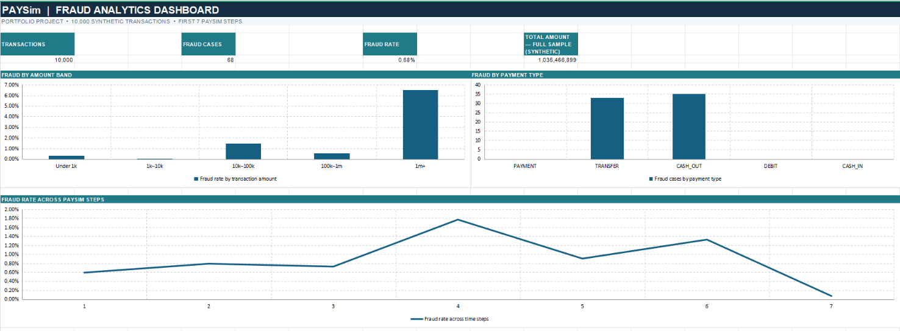
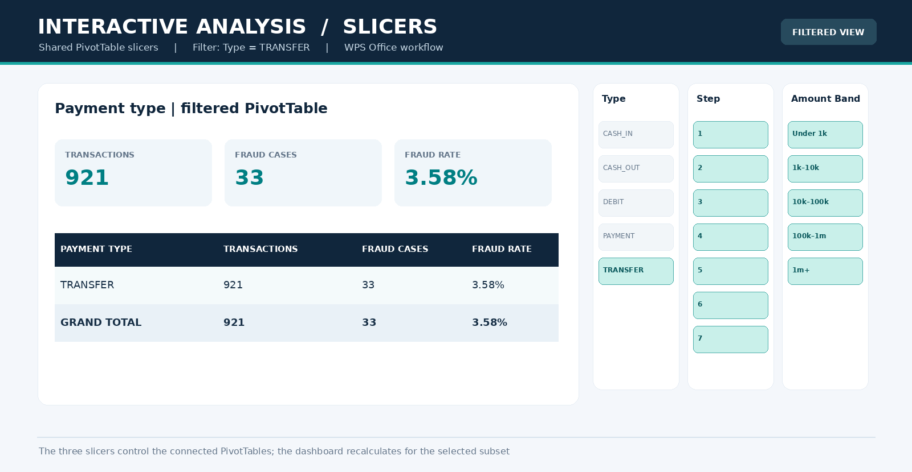
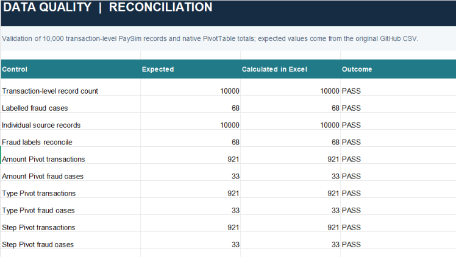

# PaySim Fraud Analytics
### Interactive Excel Dashboard · PivotTables · Slicers · Data Quality

**An Excel data analytics portfolio project exploring 10,000 synthetic financial transactions with interactive fraud reporting, category-level analysis and reconciliation checks.**

[**Download Excel workbook**](./PaySim_Fraud_Analytics_Working.xlsx) · [**View source CSV**](https://raw.githubusercontent.com/alice-patrick/decision-centric-fraud-framework/refs/heads/main/data/deployment/paysim_deployment_sample.csv) · [**Related SQL analytics**](https://github.com/alice-patrick/fraud-decision-analytics)

---

## Dashboard overview

*Redesigned portfolio visualization of the full-sample results—not a screenshot of the actual Excel interface. The downloadable workbook contains the functional PivotTables, slicers and charts.*

| Transactions | Labelled fraud | Fraud rate | Total amount |
| :-- | :-- | :-- | :-- |
| **10,000** | **68** | **0.68%** | **1,035,466,899.49** synthetic units |

**Business question:** How do labelled fraud cases vary across payment types, transaction amount bands and simulation steps, and how can an analyst explore the patterns interactively?

## Dataset & Project Objective

### Data Source

This project uses the **PaySim Synthetic Financial Dataset**, publicly available on [Kaggle](https://www.kaggle.com/datasets/ealaxi/paysim1/data).

PaySim simulates mobile money transactions and includes labelled fraudulent activity, making it suitable for exploring transaction patterns without exposing sensitive financial records.

The workbook analyses the first **10,000 transactions** from the PaySim deployment sample used across the related projects.

### Project Objective

The objective is to transform transaction-level data into an **interactive Excel reporting solution** that helps identify and communicate patterns in labelled fraud.

Specifically, the analysis aims to:

- Examine fraud frequency and rates across payment types and transaction amounts.
- Explore how transaction and fraud distributions change across simulation steps.
- Enable interactive investigation using PivotTables, connected slicers and dashboard charts.
- Validate reporting consistency through data-quality and reconciliation checks.

### Why Excel?

Excel was selected to demonstrate practical, business-oriented analytics skills: data preparation, exploratory analysis, interactive reporting and validation.

The focus is on **understanding and communicating patterns**, rather than predicting fraudulent transactions or optimising investigation decisions.

All results are descriptive and based on synthetic data.

## Key findings — full sample

| Dimension | Evidence | Interpretation |
| --- | --- | --- |
| Amount band | **10k–100k** contains **42 of 68** fraud labels (**61.8%**). | **42 / 2,841 = 1.48%** within-band fraud rate. |
| Highest observed amount-band rate | **1m+: 8 / 123 = 6.50%** | Small denominator; the rate should not be generalised. |
| Payment type | **TRANSFER: 33 / 921 (3.58%)**; **CASH_OUT: 35 / 1,321 (2.65%)** | These two categories account for all 68 labelled fraud cases in this sample. |
| Simulation step | **Step 4: 10 / 565 (1.77%)** | Highest observed rate among the first seven simulation steps; not a real-world seasonal trend. |

These observations describe the **full 10,000-row sample**. Filtered views can produce unstable percentages for very small groups.

## Interactive filtering

*Redesigned portfolio visualization of **Type = TRANSFER**: 921 transactions, 33 fraud cases and a 3.58% fraud rate. The working slicers are in the workbook's `PIVOT - TYPES` sheet.*

The workbook provides **Type**, **Amount Band** and **Step** slicers connected to three native PivotTables. Category-aware dashboard formulas prevent filtered PivotTable row movements from shifting metrics into incorrect chart categories.

The dashboard contains filter-responsive **Transactions**, **Fraud Cases** and **Fraud Rate** KPIs and three charts: fraud rate by amount band, fraud cases by payment type, and fraud rate across simulation steps. **Total Amount — Full Sample** deliberately remains static; business takeaways are explicitly full-sample observations.

## Data quality & reconciliation

*Redesigned portfolio visualization of source-level checks and filtered PivotTable reconciliation for **TRANSFER**. Actual formula-driven checks are in the workbook.*

Validation covers source counts and fraud labels, blank reporting cells, non-positive transaction amounts, and agreement between filtered totals across all three PivotTables. **Agreement between PivotTables is not independent verification against every raw transaction.**

## Excel methods

| Area | Implementation |
| --- | --- |
| Data preparation | Derived **Amount Band**, **Transactions**, **Fraud Cases** and **Fraud Amount** reporting columns |
| Analysis | Three editable native Excel PivotTables |
| Interactivity | Three slicers and shared PivotTable report connections |
| Dashboard calculations | `SUMIF`, `SUMPRODUCT`, `INDEX` / `MATCH` and `IFERROR` |
| Visualization | KPI cards, Excel charts, percentage calculations and conditional formatting |
| Quality controls | Reconciliation formulas and selected source-level checks |

**Power Query was not used.** This is an Excel-based *descriptive analytics* project, not a fraud prediction system or production banking tool.

## Workbook structure

| Sheet | Purpose |
| --- | --- |
| `START HERE` | Project context, baseline KPIs, findings and limitations |
| `SOURCE TRANSACTIONS` | 10,000 individual reporting records |
| `PIVOT - AMOUNTS` | Fraud metrics by amount band |
| `PIVOT - TYPES` | Fraud metrics by payment type; slicer controls |
| `PIVOT - STEPS` | Fraud metrics by simulation step |
| `DASHBOARD` | Filter-responsive metrics, charts and reporting tables |
| `QUALITY CHECKS` | Source-level controls and PivotTable reconciliation |

### Open and explore

1. [Download the Excel workbook](./PaySim_Fraud_Analytics_Working.xlsx) and open it in a compatible desktop spreadsheet application.
2. On `PIVOT - TYPES`, filter **Type**, **Amount Band** and/or **Step**.
3. Visit `DASHBOARD` to review filtered results and `QUALITY CHECKS` for reconciliation.
4. Clear the slicers to return to the baseline: **10,000 transactions, 68 fraud cases, 0.68% fraud rate**.

The slicers and selected scenarios were manually exercised in **WPS Office for Windows**. Behavior in other Excel-compatible applications may differ.

## Data provenance & limitations

- **Dataset:** first **10,000 rows** of the [published PaySim deployment sample](https://raw.githubusercontent.com/alice-patrick/decision-centric-fraud-framework/refs/heads/main/data/deployment/paysim_deployment_sample.csv), not the full PaySim dataset.
- **Synthetic units:** PaySim amounts are not verified EUR amounts or confirmed financial losses.
- **Descriptive scope:** observed labels and rates should not be interpreted as predictions or real-world prevalence estimates.
- **Field scope:** account identifiers and account balance fields were excluded from this workbook; account-level balance validation is outside scope.
- **Checks completed:** full-sample totals, selected amount/type/step filters, workbook reopening, matching PivotTable totals and a single-PivotTable refresh.
- **Not fully verified:** `Refresh All` after raw-data modification, every multi-slicer combination or compatibility across all Microsoft Excel versions.

## Related projects

This spreadsheet portfolio project complements more technical work while demonstrating **Excel reporting, exploratory analysis, interactive filtering and quality controls**.

- [Fraud Decision Analytics — SQL and analytics](https://github.com/alice-patrick/fraud-decision-analytics)
- [Decision-Centric Fraud Detection Framework — MSc AI prototype](https://github.com/alice-patrick/decision-centric-fraud-framework)

---

*Excel portfolio case study · Synthetic PaySim sample · Descriptive and exploratory analysis*
